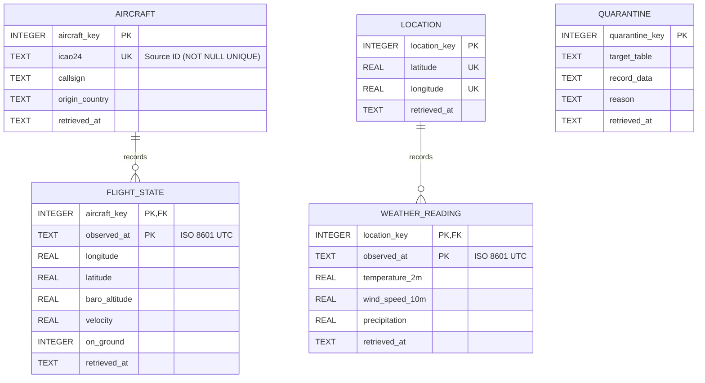

 # Aviation Delays & Weather Modeling

**Status:** M1 - ingestion complete

## The Question
This project aims to predict flight delay probabilities and duration based on meteorological conditions at both the departure and arrival locations. By joining flight logs with localized weather data, we can explain how specific storm or wind profiles impact aviation logistics. Ultimately, this model will identify which specific flight routes are most vulnerable to cascading delays during adverse weather events.

## Data Sources
* [OpenSky Network API](docs/sources.md) - Flight tracking data (Primary Source). *Attribution: Data provided by the OpenSky Network (https://opensky-network.org).*
* [Open-Meteo API](docs/sources.md) - Hourly localized weather data (Secondary Source). *Attribution: Weather data provided by Open-Meteo (https://open-meteo.com).*

## How to Run
Follow these steps to complete a full data ingestion run from a fresh clone:

```bash
# 1. Clone the repository
git clone [https://github.com/se-230717030/Aviation_Delays_Weather_Modeling](https://github.com/se-230717030/Aviation_Delays_Weather_Modeling)
cd Aviation_Delays_Weather_Modeling

# 2. Set up the environment
python -m venv venv
source venv/bin/activate  # On Windows use: venv\Scripts\activate

# 3. Install dependencies
pip install -r requirements.txt

# 4. Configure environment variables
cp .env.example .env
# Open the .env file in your text editor and update the following values:
# OPENSKY_USERNAME=your_registered_username
# OPENSKY_PASSWORD=your_registered_password

# 5. Run the ingestion script
python src/ingest.py

```
## Repository Structure
```text
aviation-delays-weather/
├── README.md             # Project overview and instructions
├── .gitignore            # Files and folders to be ignored by Git (e.g., .env, data/raw/)
├── .env.example          # Template for environment variables required by the script
├── requirements.txt      # Python dependencies required to run the script
├── data/
│   └── raw/              # Target directory for unmodified, downloaded JSON/CSV data
├── src/
│   └── ingest.py         # Main Python script to fetch and save data from the APIs
└── docs/
    └── sources.md        # Data source cards detailing provenance, licensing, and terms
```


    

## Team Information
* Muhammet Ali Öztürk (230717030) - GitHub: @se-230717030
* Muhammed Osman Kara (230717031) - GitHub: @se-230717031
* Oğuzhan Şükrü Keleş (230717016) - GitHub: @se-230717016


## Entity-Relationship (ER) Diagram

The diagram below shows the database schema created during the M2 phase of our project:


## Table Grains

The grain of each table in our database schema is described below:

* **`AIRCRAFT`**: One row represents a single aircraft with a unique identifier (`icao24`) in the OpenSky system.
* **`FLIGHT_STATE`**: One row represents the instantaneous position, altitude, and velocity measurement of a specific aircraft at a specific time (`observed_at`).
* **`LOCATION`**: One row represents a unique geographic coordinate (latitude and longitude) where weather data is recorded.
* **`WEATHER_READING`**: One row represents the weather measurements recorded at a specific location at a specific time (`observed_at`).
* **`QUARANTINE`**: One row represents a problematic raw data record that could not be loaded into the main tables due to an invalid reference or missing critical information.

## Decisions and Findings

* **Keys:** To decouple the system from external sources, surrogate keys (`aircraft_key`, `location_key`) were used in the entity tables. Natural keys from the source systems (`icao24`, `latitude`, and `longitude`) were preserved with `NOT NULL UNIQUE` constraints. For event tables, a composite key consisting of the entity ID and a timestamp was chosen as the identifier. Natural keys were tested and confirmed to be unique.
* **Missing Values:** Missing or non-numeric measurement values from the source (e.g., the absence of `baro_altitude` data when an aircraft is on the ground or data cannot be retrieved) were not silently dropped during loading; instead, they were stored as `NULL` in the database, in accordance with SQL standards.
* **Unknown References:** If an event record (e.g., flight status or weather reading) references an aircraft or location not yet registered in our database, the system does not crash. These records are routed directly to the `QUARANTINE` table. During our load testing, 78 such records were identified and successfully quarantined.
* **Change Over Time:** Recognizing that aircraft information such as `callsign` or `origin_country` might change over time, a Type 1 (Overwrite) strategy was adopted. When a new record for the same aircraft arrives, the `retrieved_at` column is checked to ensure that the most recent reading takes precedence.
* **Known Issues:** While loading the raw data, we noticed that in some records where the aircraft was reported as being in the air (`on_ground=0`), the `baro_altitude` (altitude) values were null.

## Analytical Query and Output

**Question:** Which origin countries (`origin_country`) have the highest average altitude (`baro_altitude`) recorded by their aircraft while in the air (`on_ground = 0`)?

* **Result Grain:** One row per country of origin.
* **Aggregation Logic:** Readings are aggregated at their own grain (aircraft-time). The JOIN operation with the `AIRCRAFT` table does not alter this grain. Since erroneous or non-numeric `baro_altitude` data was converted to `NULL` during the load phase, the `AVG()` function automatically ignores them and calculates the correct average based only on valid measurements.

`sql/queries/avg_altitude_by_country.sql`:
```sql
SELECT 
    a.origin_country,
    COUNT(DISTINCT a.aircraft_key) as total_aircraft_in_air,
    ROUND(AVG(fs.baro_altitude), 2) as avg_baro_altitude
FROM flight_state fs
JOIN aircraft a ON fs.aircraft_key = a.aircraft_key
WHERE fs.on_ground = 0 AND fs.baro_altitude IS NOT NULL
GROUP BY a.origin_country
ORDER BY avg_baro_altitude DESC
LIMIT 10;

Output:

| origin_country              | total_aircraft_in_air | avg_baro_altitude |
|-----------------------------|-----------------------|-------------------|
| Trinidad and Tobago         | 1                     | 12192.0           |
| Bolivia                     | 1                     | 12192.0           |
| United Republic of Tanzania | 1                     | 11879.58          |
| Kazakhstan                  | 2                     | 11277.6           |
| Iraq                        | 1                     | 11277.6           |
| Georgia                     | 4                     | 11050.91          |
| Syrian Arab Republic        | 1                     | 10965.18          |
| Lebanon                     | 1                     | 10668.0           |
| Tunisia                     | 12                    | 10556.24          |
| Saudi Arabia                | 41                    | 10540.5           |
```

## How to Build the Database and Run Checks

Follow these steps to complete a full data ingestion and database build from a fresh clone:

```bash
# 1. Clone the repository
git clone [https://github.com/se-230717030/Aviation_Delays_Weather_Modeling](https://github.com/se-230717030/Aviation_Delays_Weather_Modeling)
cd Aviation_Delays_Weather_Modeling

# 2. Set up the environment
python -m venv venv
source venv/bin/activate  # On Windows use: venv\Scripts\activate

# 3. Install dependencies
pip install -r requirements.txt

# 4. Configure environment variables
cp .env.example .env
# Open the .env file in your text editor and update the following values:
# OPENSKY_USERNAME=your_registered_username
# OPENSKY_PASSWORD=your_registered_password

# 5. Fetch raw data (M1)
python src/ingest.py

# 6. Build the database and load data (M2)
python src/load.py

# 7. Run integrity checks (M2)
python src/checks.py
```
**Status:** M2 - schema and load complete
